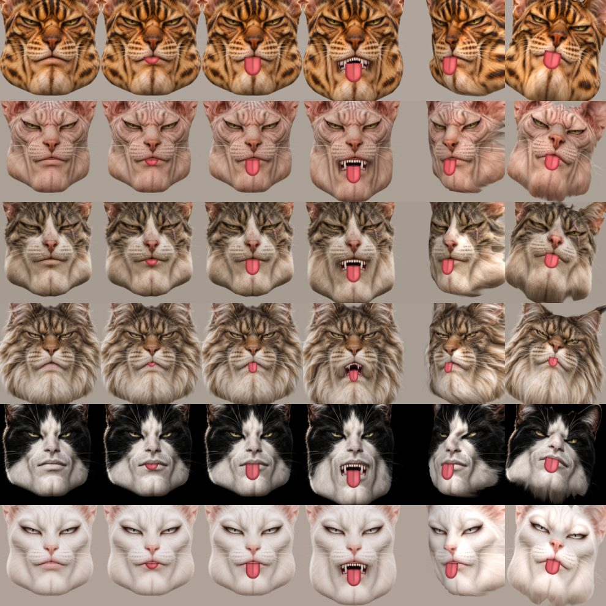

# Cat Cam

Be a cat in your Zoom calls. Pick one of seven cats; it turns, nods and tilts
with your head, copies your whole face (brows, blinks, cheeks, smile, open
mouth with fangs, and a blep when you stick your tongue out) and your hands
become its paws: the top of the paw when
you show the back of your hand, the soft toe beans when you show your palm. Its ears perk up when you raise
your brows, flatten when you frown, and twitch now and then, and the side of
its head that turns away from the light falls into shadow.

Your own face is never sent anywhere. Only the drawn cat goes out to the
virtual camera, and everything runs locally on your computer.




## Easy install (Mac with Apple Silicon)

No programming tools needed: download **Cat-Cam-<version>.dmg** from the
[Releases page](https://github.com/tarrcimar/cat-cam/releases), open it and
follow *Read me first.txt* inside. In short: drag Cat Cam to Applications,
set up OBS's virtual camera once (step 2 below), and the first time you open
Cat Cam allow it under *System Settings → Privacy & Security → Open Anyway*.

The rest of this page is for running it from the code instead.

## What you need

- **macOS**. It is developed and tested on Apple Silicon. Windows should work
  too (pyvirtualcam and OpenGL both support it) but is untested.
- A webcam.
- [**uv**](https://docs.astral.sh/uv/), which installs Python and all
  libraries for you.
- [**OBS Studio**](https://obsproject.com). Only its virtual camera driver is
  used; OBS itself stays closed.

## One-time setup

1. **Install uv**:

   ```sh
   curl -LsSf https://astral.sh/uv/install.sh | sh
   ```

2. **Install OBS and enable its virtual camera.** Run
   `brew install --cask obs` or download it from obsproject.com. Then:
   1. Open OBS and click **Start Virtual Camera**.
   2. When macOS asks, allow the system extension. You may need to approve it
      under *System Settings → General → Login Items & Extensions*.
   3. Click **Stop Virtual Camera** and **quit OBS**.

   You only do this once. Afterwards, keep OBS closed while Cat Cam runs, or
   it takes the virtual camera for itself.

3. **Allow keyboard access for your terminal app.** A few keyboard
   shortcuts also work while Zoom is in front, which macOS only allows with
   *Input Monitoring*. macOS usually does **not** ask for it by itself:
   1. Open *System Settings → Privacy & Security → Input Monitoring*.
   2. If your terminal app (Terminal, iTerm, Warp, ...) isn't in the list,
      click **+** at the bottom, choose it from *Applications*, and add it.
   3. Switch it on.
   4. **Quit and reopen the terminal app** (⌘Q). The permission only takes
      effect after a restart.

4. **Get the code**:

   ```sh
   git clone https://github.com/tarrcimar/cat-cam.git
   cd cat-cam
   ```

## Run it

```sh
uv run cat-cam
```

The first run downloads the libraries, which takes a minute. macOS then asks
whether your terminal may use the camera; allow it. If you said no, enable it
under *System Settings → Privacy & Security → Camera* and run again.

A window opens with the cat picker. Click a cat, or press its number.

In Zoom, go to *Settings → Video → Camera* and choose **OBS Virtual Camera**.
Do the same in any other app (Meet, Teams, FaceTime, ...). If the camera is
not listed, restart Zoom while Cat Cam is running.

Keep a relaxed face for the first second. The cat compares your face against
how it looks at the start, and the way you sit at the start counts as "looking
at the viewer". If the cat looks grumpy or turned while you are relaxed, press
`n`.

Stick your tongue out and the cat does a blep: its tongue slides out over its
lower lip, as far as yours is out, and back in when yours goes back in.

Raise your hands into the camera's view for paws. Turn a hand around to
show the other side of the paw, and make a fist to curl its toes in.
Tick **Tail** in the top left corner of the window (or press `t`) and your
right hand lifts the tip of the cat's tail instead of a paw: the rest of
the tail rises from below, trails behind, curls and swishes on its own.
Untick it to get the paw back.

### Keys (in the Cat Cam window)

| Key        | What it does                                              |
|------------|-----------------------------------------------------------|
| `1` to `7` | switch cat, at any time                                   |
| `c`        | open the cat picker (the call keeps showing your cat)     |
| `Esc`      | close the picker                                          |
| `t`        | tail on/off (same as the Tail checkbox)                   |
| `n`        | "this is my neutral face": recalibrate face and head pose |
| `q`        | quit (closing the window or Ctrl+C also works)            |

The preview in the window is mirrored, like a mirror. The call gets the
unmirrored picture, just as a normal camera would send.

### Options

```sh
uv run cat-cam --camera 1   # use another webcam (e.g. if your iPhone camera opens)
```

## Troubleshooting

| Problem | Fix |
|---|---|
| `Cannot open webcam` | Allow camera access for your terminal (see above). If you have several cameras, try `--camera 1`. |
| Error about the virtual camera | Do the OBS setup above, and make sure OBS is **not** running. |
| Zoom shows a black picture | OBS is probably running; quit it and restart Cat Cam. |
| Zoom does not list "OBS Virtual Camera" | Restart Zoom while Cat Cam is running. |
| The cat looks off while you are relaxed | Press `n` with a neutral face. |
| "Looking for your face..." | Face the camera and make sure your face is lit. |

## Add your own cat

1. Put a portrait in `all_cats/<Name>.png`. It works best when the face looks
   straight at the camera with the mouth closed, against a plain background.
2. Prepare it. This cuts the cat out and finds its face, and takes about
   10 seconds per cat:

   ```sh
   uv run --group prepare python -m catcam.prepare
   ```

   The results go to `assets/cats/<Name>/`. Already prepared cats are skipped;
   add `--force` to redo them, or name cats to do only those.
   Optionally add paw photos next to it: `all_cats/<Name>PawsFront.png`
   (the front legs seen from the front, as if the cat stood facing you) and
   `all_cats/<Name>PawsBack.png` (the soles). In each, put the left paw on
   the left and the right paw on the right, separated by a vertical purple
   line. `prepare` cuts them out too; a cat without paw photos gets drawn
   paws in its colours.
3. Run `uv run cat-cam`. The new cat appears in the picker.

## Tuning

These constants sit at the top of their files:

| Constant | File | Effect |
|---|---|---|
| `EXPRESSION_GAIN` | `catcam/app.py` | how exaggerated the cat's expressions are (1 = same as you) |
| `EXPRESSION_MIN_CUTOFF`, `EXPRESSION_BETA` | `catcam/app.py` | face smoothing: lower cutoff means less jitter, higher beta means less lag |
| `ROTATION_MIN_CUTOFF`, `ROTATION_BETA` | `catcam/app.py` | the same for head movement |
| `BLINK_RANGE` | `catcam/app.py` | how far you close your eyes before the cat blinks |
| `FILLED_RANGE`, `OPENING_RANGE` | `catcam/tongue.py` | how much of your mouth opening must be tongue, and how far open the mouth must be, before the cat's tongue shows and when it is fully out |
| `TONGUE_HUE`, `TONGUE_SATURATION`, `TONGUE_BRIGHTNESS` | `catcam/tongue.py` | which colours count as tongue in the webcam picture |
| `WIDTH`, `LENGTH`, `CURL` | `catcam/tongue.py` | the size of the tongue (in mouth widths) and how much its tip comes toward the viewer |
| `TONGUE_SMOOTHING` | `catcam/app.py` | how quickly the tongue slides out and back in |
| `FLATTEN`, `PERK`, `TWITCH_EVERY` | `catcam/ears.py` | how far the ears move, and how often they twitch |
| `STRENGTH`, `LIGHT` | `catcam/lighting.py` | how much turning the head changes its shading, and where the light comes from |
| `PAW_SIZE` | `catcam/paws.py` | paw size relative to your hand |
| `TAIL_HAND`, `LENGTH`, `SWISH`, `DRAG` | `catcam/tail.py` | which hand moves the tail, how long it is, how much it sways by itself, and how quickly it calms down |
| `TOP_MARGIN`, `CHIN_LINE` | `catcam/cat_mesh.py` | how much of the screen the cat fills |

## How it works

1. MediaPipe tracks 478 points on your face plus your hands, from the webcam.
2. Each cat has the same 478 points, found once by `catcam.prepare`. The
   cats have human-like faces, so the human face model fits them.
3. Your points are aligned to your neutral face, which removes head position,
   rotation and distance. What remains is your expression. That is mapped onto
   the cat's points (`catcam/face_motion.py`).
4. The cat photo is a textured 3D mesh. It is deformed by your expression,
   rotated by your head pose and drawn with OpenGL, shaded by how much each
   part turned toward or away from the light (`catcam/lighting.py`). The
   mouth's inside and cat teeth are drawn in the gap between the lips,
   coloured to match the cat's lips (`catcam/cat_mesh.py`). When you stick
   your tongue out, a tongue hung from the lower lip of the mesh slides out
   over it, in the same colours (`catcam/tongue.py`). The face model has no
   tongue score, so the tongue is found in the webcam picture instead: how
   much of the opening between your lips is filled with something bright
   and red rather than the dark of the mouth or the white of teeth.
5. Blinks lower the cat's eyelids in its texture (`catcam/cat_face.py`), the
   ears bend about a hinge below their tips (`catcam/ears.py`), and paws are
   drawn where your hands are (`catcam/paws.py`), showing their top or their
   sole depending on which way your hand faces. A tail (`catcam/tail.py`) is
   a chain of points whose tip is pulled toward your hand; the rest is
   simulated with momentum, even bending and a bend limit, and wrapped in the
   skin of the cat's paw photo.
6. The frame goes to the OBS virtual camera through pyvirtualcam.

## Development

Want to contribute or make a release? See [CLAUDE.md](CLAUDE.md).

```sh
uv run pytest          # tests, including render checks on every cat
uv run ruff check .    # lint
uv run cat-cam --check # load and draw every cat once, without a camera
```

To build the standalone app and its disk image (`dist/Cat-Cam-<version>.dmg`)
on an Apple Silicon Mac:

```sh
packaging/build_mac.sh
```

```
catcam/
  app.py           main loop: webcam -> tracking -> render -> virtual camera
  picker.py        the cat picker
  cats.py          finding and loading prepared cats
  cat_mesh.py      the 3D head mesh and its OpenGL rendering
  cat_face.py      eyelids
  tongue.py        the tongue that comes out when yours does (a blep)
  ears.py          ear movement
  lighting.py      shading as the head turns
  face_motion.py   expression transfer
  head_pose.py     head rotation and the One Euro smoothing filter
  paws.py          paws
  tail.py          the tail: a chain of points simulated like a real tail
  paw_photos.py    turns paw photos into paw sprites (used by prepare)
  prepare.py       turns all_cats/*.png into assets/cats/*
  landmark_fit.py  finds a cat's face points (used by prepare)
all_cats/          source portraits
assets/cats/       prepared cats (cutout + face points), used at runtime
models/            MediaPipe face and hand models
packaging/         the standalone macOS app: PyInstaller spec, icon, build script
```

The MediaPipe models in `models/` are by Google and licensed under Apache 2.0.
